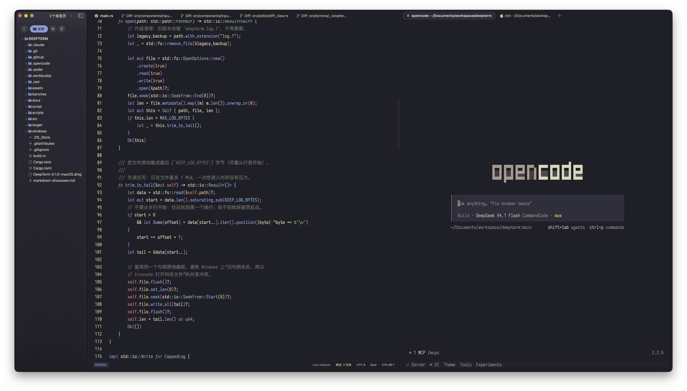

<p align="center">
  
</p>

<h1 align="center">DeepTerm</h1>

<p align="center">
  <strong>Rust + GPUI 打造的现代终端模拟器</strong><br />
  终端、SSH/SFTP、编辑器与 AI CLI Agent，一站式工作台
</p>

<p align="center">
  <a href="https://github.com/cherryicake/deepterm/actions/workflows/ci.yml">
    
  </a>
  
  
  
</p>

<p align="center">
  
</p>

## 简介

DeepTerm 是一个使用 **Rust** 编写、基于 **GPUI**（Zed 的 GPU 加速 UI 框架）构建的终端模拟器。它不只提供终端，还把 SSH 远程连接、文件管理、代码编辑和 AI CLI Agent 状态提示集成在同一个窗口里。

## 主要功能

- **GPU 终端**：基于 `alacritty_terminal`，支持标签页、分屏、搜索、Shell 集成、Kitty 图形协议、桌面通知与主题热重载。
- **SSH / SFTP**：主机管理与系统凭据存储，远程终端、远程文件浏览与编辑、上传下载、反向端口转发和远程 LSP。
- **代码编辑器**：tree-sitter 语法高亮，LSP 补全/悬浮/诊断/跳转，Git 状态与 Diff（只读评审视图，单栏/并排可切换），Vim 模式，Markdown 实时预览和图片查看。
- **AI CLI Agent**：自动识别 Claude Code、Codex、OpenCode 等 28 种命令行 Agent，并在标签页显示工作中、等待确认、已完成三种状态。
- **会话体验**：多窗口、标签页组、会话恢复，以及 `/open`、`/scp` 内建命令。

## 快速开始

### 环境要求

- [Rust](https://www.rust-lang.org/) 1.95+
- macOS / Linux / Windows（主要开发与验证平台为 macOS）
- macOS 需要 Xcode Command Line Tools；Xcode 27+ 还需安装 Metal Toolchain

### 从源码运行

```bash
git clone https://github.com/cherryicake/deepterm.git
cd deepterm
cargo run --release
```

### 打包

```bash
# macOS：生成 DMG
./scripts/build-dmg.sh

# Debian / Ubuntu：生成 .deb
./scripts/build-deb.sh
```

Windows 安装包使用 Inno Setup 编译 `windows/deepterm.iss`。


---

如果这个项目对你有帮助，欢迎点一个 Star ⭐
